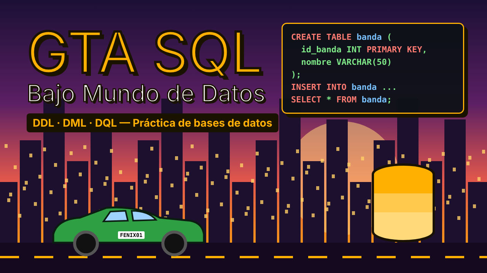

<p align="center">
  
</p>

<h1 align="center">GTA SQL: Bajo Mundo de Datos</h1>

<p align="center"><strong>SHANUKI</strong></p>

<p align="center"><strong>Práctica de SQL (DDL, DML y DQL) en forma de juego de mundo abierto, para Introducción a Bases de Datos.</strong></p>

---

## ¿Qué es?

Un juego retro de vista superior que corre en el navegador. El estudiante es **Byte**, una hacker que entra a la **Familia Ceibo** en la ciudad de Santa Bruma. Maneja por la ciudad, cumple misiones y, en cada una, un personaje le pide trabajar sobre la base de datos clandestina de la banda en una **terminal SQL** dentro del juego.

La misión no avanza hasta que la base (o el resultado de la consulta) cumple el objetivo. Se evalúa **la lógica, no el texto**: mayúsculas, espacios, alias, orden de columnas o una consulta distinta que da el mismo resultado no hacen fallar la fase.

## Las misiones

| Misión | Tema | Qué se practica |
|---|---|---|
| 1. La libreta quemada | DDL | `CREATE DATABASE`, `USE`, `CREATE TABLE`, `PRIMARY KEY`, `FOREIGN KEY` |
| 2. El garaje y los golpes | DDL | Más tablas, tipos de datos, relación N:M con clave primaria compuesta |
| 3. Cambio de planes | DDL | `ALTER TABLE … ADD / MODIFY / DROP COLUMN`, `DROP TABLE` |
| 4. Reclutamiento | DML | `INSERT` respetando el orden de las claves foráneas |
| 5. El libro de golpes | DML | `INSERT` en la tabla intermedia, fechas |
| 6. Ajuste de cuentas | DML | `UPDATE` (con y sin cálculo), `DELETE` y el error 1451 |
| 7. Informe para la jefa | DQL | `SELECT`, `WHERE` con `AND`, `ORDER BY … DESC` |
| 8. Conexiones | DQL | `JOIN` de 2 y 3 tablas |
| 9. El gran golpe | DQL | `COUNT`, `SUM`, `GROUP BY`, `HAVING` |

Son **27 fases** en total. Además está el **Cuartel del Hacker** (CASA-63) y el botón **SQL** de la parte de abajo: abren una **práctica libre** sobre la misma base, que no cambia la nota.

El modelo de datos es el mismo de la evaluación (BANDA, MIEMBRO, VEHICULO, MISION, PARTICIPA_MISION), con datos distintos.

## La terminal SQL

- Mensajes de éxito y error **estilo MySQL** (`ERROR 1452 (23000): Cannot add or update a child row…`), cada error con una pista corta en español.
- Panel con la consigna en **lectura fácil** y la tabla de datos del "expediente" cuando hay que cargar filas.
- Si la lógica falla, la retroalimentación dice **dónde revisar** (la tabla, el WHERE, el orden, una columna que falta) y nunca muestra la solución.
- Panel **🗂 Tablas** con la estructura de la base (PK, FK, tipos y cantidad de filas).
- **Copiar código de esta fase**: copia las sentencias correctas ya ejecutadas.
- **Reparar base**: deja la base como estaba según las fases logradas (útil si se rompió algo en la práctica libre).
- Historial con `Ctrl + ↑ / ↓`, ejecutar con `Ctrl + Enter`.
- **Tema claro/oscuro**: sigue al sistema operativo, con botón para cambiarlo.

### Reporte de avance

El chip **📊 Nota** abre el reporte: nombre y grupo del estudiante, nota en vivo **(fases logradas ÷ 27) × 10**, avance por DDL/DML/DQL, estado de cada fase y botón **Imprimir / Guardar PDF** (usa el diálogo del navegador).

Todo se guarda **en el navegador del estudiante** (`localStorage`): base de datos, progreso, nombre y tema. No hay servidor ni cuentas. Si cambia de computadora o borra los datos del navegador, empieza de cero.

## Cómo publicarlo con GitHub Pages

1. En el repositorio: **Settings → Pages**.
2. En *Source* elegí **Deploy from a branch**, rama `main`, carpeta `/ (root)`.
3. Guardá. En un par de minutos queda en `https://<usuario>.github.io/<repositorio>/`.

## Correrlo en la computadora

El juego usa módulos de JavaScript, así que hay que servir la carpeta por HTTP (no abrir el `index.html` con doble clic):

```bash
python3 -m http.server 8080
```

Después abrí `http://localhost:8080`.

Pruebas automáticas (motor del juego + intérprete SQL + verificación de las 27 fases):

```bash
node --test tests/*.test.js
```

## Alcance técnico del intérprete SQL

La terminal **no usa un motor de base de datos real**: es un intérprete propio (`src/sql/sql-engine.js`) que imita la sintaxis y los mensajes de **MySQL 8**. Soporta:

- **DDL**: `CREATE/DROP DATABASE`, `USE`, `SHOW DATABASES/TABLES`, `DESCRIBE`, `SHOW CREATE TABLE`, `CREATE TABLE` (tipos `INT`, `TINYINT`, `SMALLINT`, `BIGINT`, `DECIMAL`, `FLOAT`, `DOUBLE`, `VARCHAR`, `CHAR`, `TEXT`, `DATE`, `DATETIME`, `TIME`, `BOOLEAN`, `ENUM`; `NOT NULL`, `DEFAULT`, `AUTO_INCREMENT`, `PRIMARY KEY` simple y compuesta, `UNIQUE`, `CHECK`, `FOREIGN KEY … REFERENCES` con `ON DELETE/UPDATE CASCADE | SET NULL | RESTRICT`), `ALTER TABLE` (`ADD`, `DROP COLUMN`, `MODIFY`, `CHANGE`, `RENAME COLUMN`, `RENAME TO`, `ADD/DROP PRIMARY KEY`, `ADD/DROP FOREIGN KEY`, `ADD CONSTRAINT`, `ALTER COLUMN … SET/DROP DEFAULT`), `DROP TABLE`, `TRUNCATE`, `RENAME TABLE`.
- **DML**: `INSERT` (varias filas, lista de columnas, `INSERT … SET`, `INSERT … SELECT`), `UPDATE` y `DELETE` con `WHERE`, `ORDER BY` y `LIMIT`. Controla tipos, largo de texto, fechas, `NOT NULL`, claves duplicadas, `CHECK` y claves foráneas (errores 1048, 1062, 1366, 1406, 1292, 1451, 1452, 3819…).
- **DQL**: `SELECT` con `DISTINCT`, alias, `*` y `tabla.*`, `WHERE` (`AND`, `OR`, `NOT`, `BETWEEN`, `IN`, `LIKE`, `IS NULL`), `JOIN` (`INNER`, `LEFT`, `RIGHT`, `CROSS`, `NATURAL`, `USING`, o con coma + `WHERE`), `GROUP BY`, `HAVING`, `ORDER BY` (por nombre, alias o posición), `LIMIT/OFFSET`, `UNION`, subconsultas (`IN`, `EXISTS`, escalares y en el `FROM`), funciones de agregado (`COUNT`, `SUM`, `AVG`, `MIN`, `MAX`, `GROUP_CONCAT`) y funciones comunes (`UPPER`, `LOWER`, `CONCAT`, `LENGTH`, `ROUND`, `YEAR`, `NOW`, `IFNULL`, `CASE`…).

No incluye vistas, procedimientos, triggers, transacciones, usuarios/permisos (`GRANT`) ni índices reales. Agregar un comando nuevo requiere extender el intérprete.

Las fases, sus consignas y cómo se verifica cada una están en `src/sql/challenges.js`. Las misiones (diálogos, lugares y objetos) están en Markdown dentro de `story/`; la directiva `- SQL: mision-N` en una escena abre la terminal con las fases de esa misión.

## Créditos

**Recurso educativo del proyecto SHANUKI** para las clases de Introducción a Bases de Datos (Plan Ceibal, Uruguay).

El motor del juego (ciudad, tránsito, física, escenas, inventario) es el proyecto de código abierto **GTA — Guanabara Testando Agentes**, creado por Gustavo Guanabara ([Curso em Vídeo](https://www.youtube.com/cursoemvideo)). Esta versión reemplaza la historia, traduce la interfaz al español y agrega la terminal SQL, las fases y el reporte de avance.
